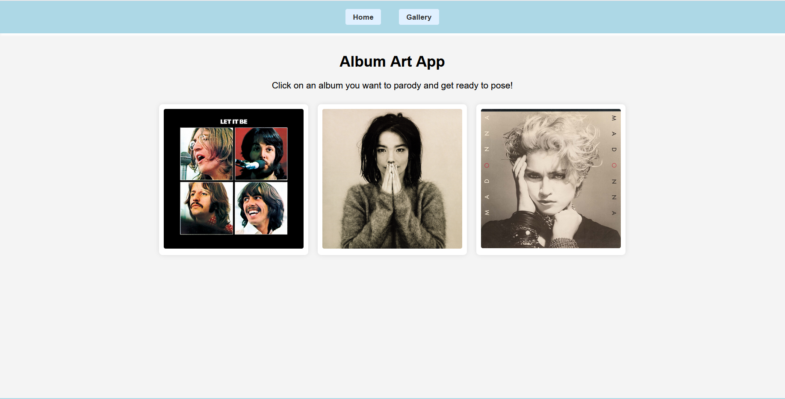
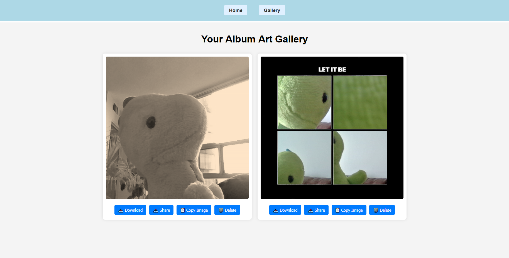

# album-art-app
Album Art App

## Demo Video

## Project Resources
- [Issue Board](https://github.com/users/erinhollett/projects/1)
- [Feature Branches](https://github.com/erinhollett/album-art-app/branches)

## Project Purpose
Album Art App is an interactive website that lets users create parody album covers featuring themselves.  
The project was inspired by the idea of a photo booth: users select a template, pose in front of their webcam, and receive a final “album cover” styled image. 

## Main Features
- **Template Selection** – choose from three parody album cover templates  
- **Pose Overlay** – a transparent overlay will help to guide users to match the original cover pose  
- **Countdown Timer** – a short timer gives users a few seconds to prepare before capture  
- **Image Capture & Processing** – snapshots are cropped, filtered, and composited with album templates using the Canvas API and/or image processing
- **Local Storage Integration** – generated images are automatically saved with unique IDs  
- **Gallery Page** – users can view all saved creations and perform actions:
  - Download images as PNGs  
  - Copy images to clipboard
  - Share images (via Web Share API on mobile)  
  - Delete images from localStorage  

All functionality is handled **locally** in the browser. No server or backend required.

## Screenshots

## Contributors
### [Erin Hollett](https://github.com/erinhollett) – JavaScript Developer & Frontend Developer
- Implemented webcam integration, photo capture, and storage setup  
- Overlaid pose guides with Canvas and CSS  
- Built countdown timer UX  
- Composited final album cover using Canvas API / image processing  
- Saved generated images to localStorage  

### [Bishoy Elgndi](https://github.com/BishoyElgndin01292902) – Frontend Developer & Designer
- Built website structure and navigation with HTML/CSS  
- Styled all pages for usability and responsiveness  
- Created the gallery page to display saved covers  
- Implemented download/share buttons  
- Collaborated on testing and UX polish  

### [Amber Forrest](https://github.com/amber4est) – Frontend Developer (Polish & QA)
- Contributed bug fixes, testing, and debugging  
- Updated features and improved UX/CSS  
- Helped polish design and functionality during final project stages  
